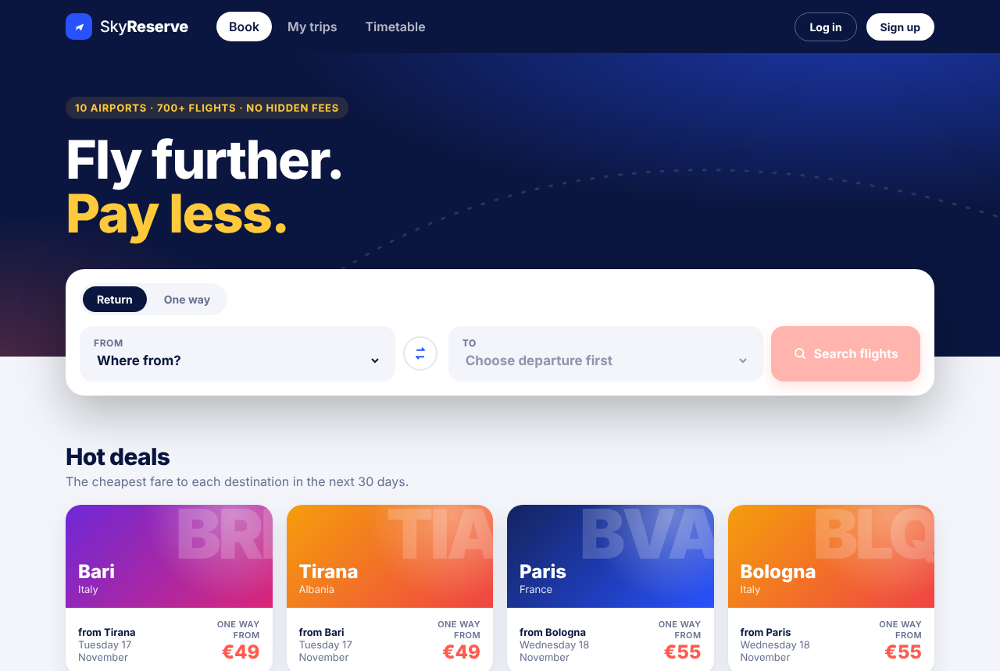
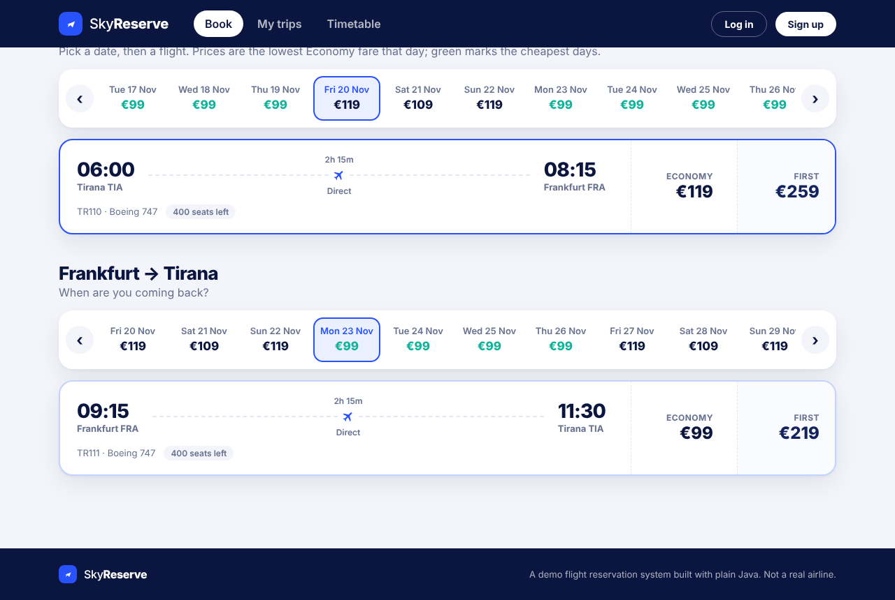
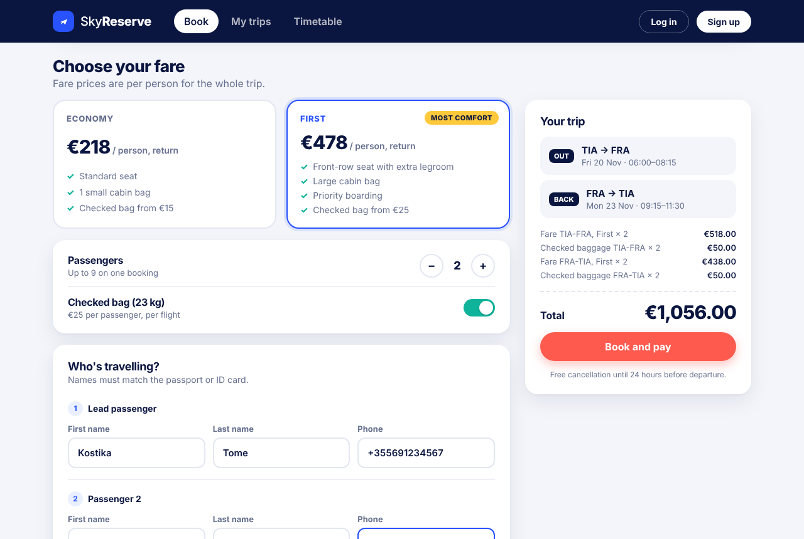
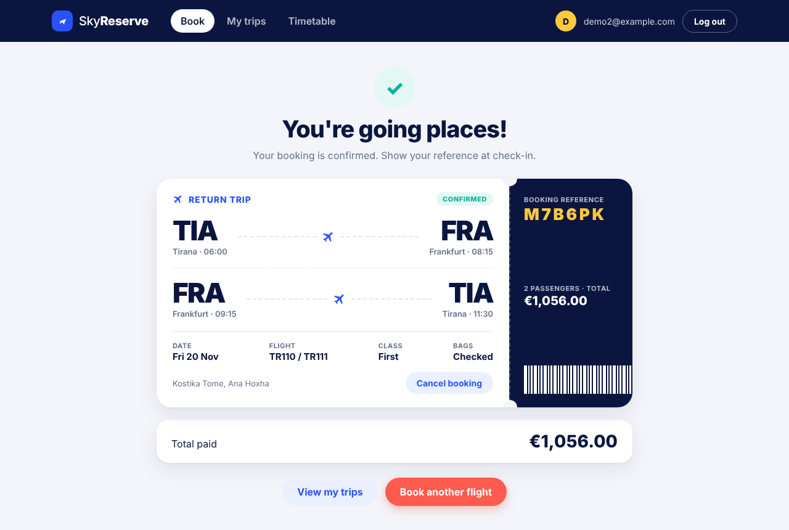
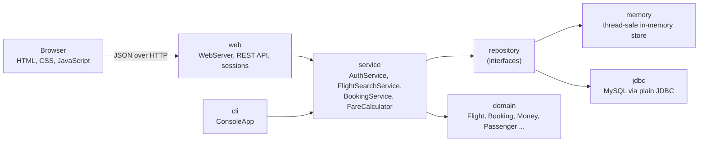

# Ticket Reservation System

[](../../actions/workflows/ci.yml)


A flight ticket reservation system written in plain Java 17, with no frameworks.
Customers create an account, search flights, see a live itemised price, book one-way or
round trips for up to 9 passengers, and view or cancel their bookings. It has a browser UI
backed by a JSON REST API, and a console UI on the same services.



The focus is on correctness rather than features:

- **No overbooking, even under concurrency.** Seat reservation is a single conditional
  `UPDATE ... WHERE available_seats >= ?` inside a transaction. A test fires 60 parallel
  bookings at a 180-seat aircraft and checks that exactly 45 succeed.
- **All-or-nothing bookings.** A round trip reserves seats on both flights and stores the
  booking in one transaction. If either flight is full, nothing changes.
- **Money is never a `double`.** Prices use a `Money` value type backed by `BigDecimal`,
  with currency checks and an itemised quote whose lines always add up to the total.
- **Secure accounts.** Passwords are hashed with salted PBKDF2-HMAC-SHA256 (600,000
  iterations), compared in constant time, and wiped from memory after use. Login errors
  don't reveal whether an email is registered, and other users' bookings are invisible.
- **Two interchangeable storage engines.** The in-memory and MySQL/JDBC repositories both
  pass the same contract test suite.
- **A hardened web layer.** The server listens on localhost only and uses bearer-token
  sessions, so CSRF isn't possible. It limits request size, sends a strict Content Security
  Policy, and never returns stack traces. The front end builds the page with DOM methods, never
  `innerHTML`, so flight or passenger data can't inject script.

## Quick start

Requirements: **JDK 17+** and **Maven 3.9+**.

```bash
mvn package                               # compile, run all tests, build the jar
java -jar target/ticket-reservation.jar   # starts the web UI and opens http://localhost:8080
```

Demo data covers 10 European airports and about 700 flights over the next 30 days. You can
register any account and start booking straight away.

| Command                                                | What it does                     |
| ------------------------------------------------------ | -------------------------------- |
| `java -jar target/ticket-reservation.jar`              | Web UI, opens your browser       |
| `java -jar target/ticket-reservation.jar --no-browser` | Web UI without opening a browser |
| `java -jar target/ticket-reservation.jar --console`    | Text UI in the terminal          |

| Dates with prices                      | Fares and live price                       | Boarding-pass confirmation                         |
| -------------------------------------- | ------------------------------------------ | -------------------------------------------------- |
|  |  |  |

### Running with MySQL

```bash
docker compose up -d                      # MySQL 8.4 on localhost:3306

export TR_STORAGE=jdbc
export TR_DB_URL=jdbc:mysql://localhost:3306/ticket_reservation
export TR_DB_USER=ticket_app
export TR_DB_PASSWORD=change-me
java -jar target/ticket-reservation.jar   # creates the tables on first start
```

| Variable            | Default                                          | Description                                  |
| ------------------- | ------------------------------------------------ | -------------------------------------------- |
| `TR_STORAGE`        | `memory`                                         | `memory` (no setup) or `jdbc`                |
| `TR_DB_URL`         | `jdbc:mysql://localhost:3306/ticket_reservation` | JDBC URL                                     |
| `TR_DB_USER`        | `ticket_app`                                     | Database user                                |
| `TR_DB_PASSWORD`    | _(empty)_                                        | Database password                            |
| `TR_SEED_DEMO_DATA` | `true`                                           | Add demo flights when none are scheduled     |
| `TR_PORT`           | `8080`                                           | Port of the web UI (bound to localhost only) |

Credentials are only ever read from the environment, never from the source code.

## Architecture



```
src/main/java/com/ticketreservation
├── App.java              wiring (constructor injection, no framework)
├── web/                  REST API on the JDK HTTP server, JSON helper, sessions
├── cli/                  console UI: menus, input validation, tables
├── config/               configuration from environment variables
├── domain/               immutable records that validate themselves
├── exception/            business exceptions shown to the user
├── repository/           storage interfaces
│   ├── memory/           in-memory implementation (one lock, atomic operations)
│   └── jdbc/             JDBC implementation (transactions, retries, parameterised SQL)
└── service/              business rules: auth, search, pricing, booking, demo data
src/main/resources/db/schema.sql   MySQL schema with foreign keys and CHECK constraints
src/main/resources/web/            browser front end (vanilla JavaScript, no build step)
```

Design decisions:

- **Business rules live in the services**, not in the UI or the database layer. The web API
  and the console UI are both thin clients of the same services.
- **Domain objects are immutable records** that validate in their constructors, so you can't
  create a flight that lands before it departs, a negative price or an invalid passenger.
- **Time is injected as a `Clock`**, so rules like "no cancellations within 24 hours of
  departure" are tested deterministically.
- **Repositories own atomicity.** `BookingRepository.create` reserves seats and inserts the
  booking as one unit. The JDBC version updates flights in id order to avoid deadlocks, and
  retries transactions the database aborts because of a deadlock or write conflict.
- **A booking's price is fixed when it is made**, so later fare changes don't alter what the
  customer paid.

## REST API

Endpoints marked 🔒 need an `Authorization: Bearer <token>` header from login or register.
Errors are returned as `{"error": "message"}` with a matching status code: 400 invalid input,
401 not logged in, 404 not found, 409 seats sold out or email taken.

| Method | Path                                  | Description                                 |
| ------ | ------------------------------------- | ------------------------------------------- |
| POST   | `/api/auth/register`                  | Create an account, returns a session token  |
| POST   | `/api/auth/login`                     | Log in, returns a session token             |
| POST   | `/api/auth/logout`                    | End the session                             |
| GET    | `/api/airports/origins`               | Airports with upcoming departures           |
| GET    | `/api/airports/{code}/destinations`   | Destinations served from an airport         |
| GET    | `/api/routes/{from}/{to}/dates`       | Bookable dates with the lowest fare per day |
| GET    | `/api/deals`                          | Cheapest upcoming fare to each destination  |
| GET    | `/api/flights/search?from=&to=&date=` | Flights on a route and day, with free seats |
| GET    | `/api/flights/{id}/returns`           | Return flights for an outbound flight       |
| GET    | `/api/flights?q=`                     | All upcoming flights, optional text filter  |
| POST   | `/api/quote`                          | Itemised price for a trip                   |
| POST   | `/api/bookings` 🔒                    | Book a trip                                 |
| GET    | `/api/bookings` 🔒                    | Your bookings, newest first                 |
| GET    | `/api/bookings/{reference}` 🔒        | One of your bookings                        |
| POST   | `/api/bookings/{reference}/cancel` 🔒 | Cancel a booking and release its seats      |

```bash
curl -X POST localhost:8080/api/quote -H "Content-Type: application/json" \
     -d '{"outboundFlightId": 1, "fareClass": "ECONOMY", "checkedBaggage": true, "passengerCount": 2}'
```

## Business rules

| Rule                   | Value                                                                               |
| ---------------------- | ----------------------------------------------------------------------------------- |
| Passengers per booking | 1 to 9                                                                              |
| Price                  | per flight: (class fare + optional baggage fee) × passengers                        |
| Checked baggage fee    | Economy €15, First €25 (per passenger, per flight)                                  |
| Round trip             | Return flight must fly the reverse route and depart after the outbound flight lands |
| Online booking closes  | 45 minutes before departure                                                         |
| Cancellation           | Allowed until 24 hours before departure; seats are released                         |
| Booking reference      | 6 random characters without look-alikes (no 0/O, 1/I/L)                             |
| Password               | 8 to 128 characters, at least one letter and one digit                              |

## Tests

```bash
mvn test
```

There are 104 JUnit 5 tests covering:

- **Domain:** money arithmetic, validation of flights, airports and passengers.
- **Services:** pricing, the booking rules above, cancellation, access control between
  users, authentication and password hashing.
- **Repository contract (`RepositoryContractTest`):** one abstract suite run against both
  the in-memory store and the JDBC repositories on H2 in MySQL mode. It covers atomic
  round-trip bookings, rollbacks, seats released exactly once, and the 60-thread
  overbooking test.
- **Web API:** starts the real HTTP server and calls every endpoint over HTTP. It covers the
  booking flow, sessions, access control between users, error status codes, the request size
  limit and security headers.
- **Console UI:** end-to-end scripted sessions (register → book → cancel), invalid input and
  end of input.

On every push, CI builds on Java 17 and 21 and runs the repository contract against a real
MySQL 8 server.

## Possible extensions

- Seat selection and seat maps
- Payment provider integration with idempotency keys
- Schema migrations with Flyway, and a connection pool (HikariCP)

## Background

This project started as a university assignment with JavaFX and MySQL. This version is a full rewrite
in English, focused on code quality, testing improved UI and functionality and correctness.
